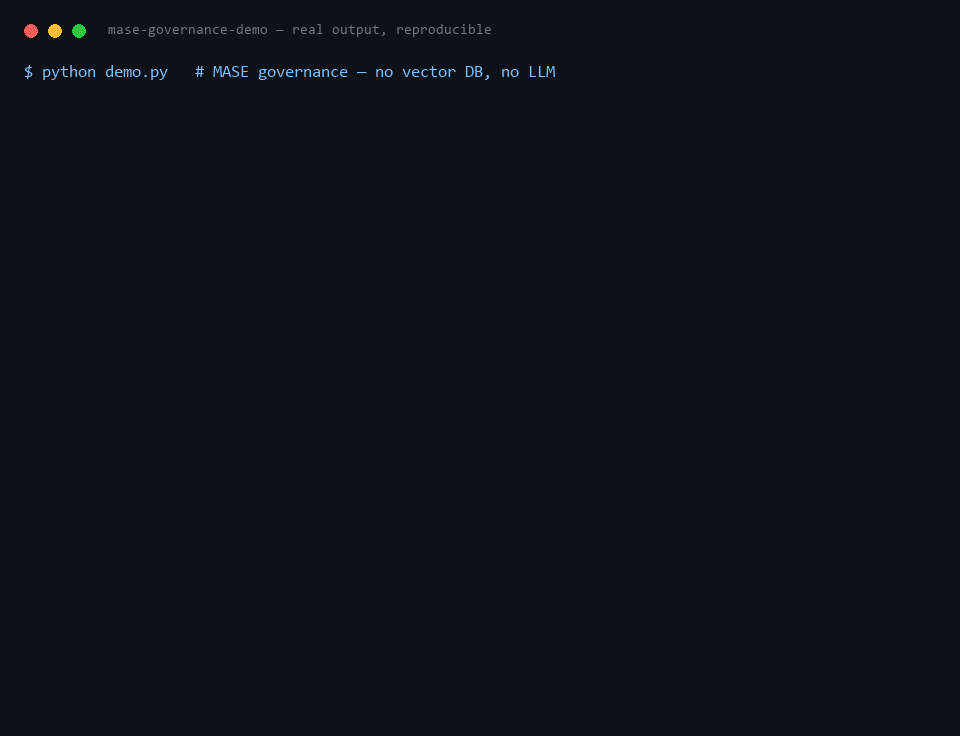
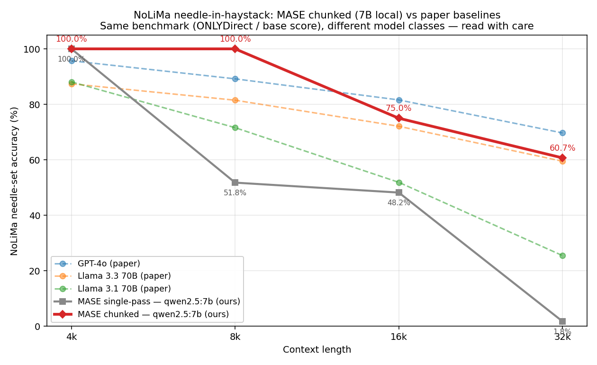

<div align="center">

# MASE

**Dual-whitebox memory for LLM agents.**

> Make agent memory readable, editable, auditable, and testable before sending it back into the model context.

[](https://github.com/zbl1998-sdjn/MASE-agent-memory/actions/workflows/ci.yml)


<a href="docs/README_zh.md">中文</a> | <b>English</b>



<sub>Real output from `demo_governance.py` — no vector DB, no LLM. A corrected fact supersedes the old one; an answer that reuses the stale value is refused by the claim verifier.</sub>

</div>

## What is MASE?

MASE is a **dual-whitebox memory engine** for LLM agents.

Most agent memory systems start with an opaque vector store: write everything, embed everything, retrieve top-k chunks, and hope the model resolves conflicts. MASE takes the opposite path:

1. **Govern memory first.**
2. **Keep the minimum necessary facts.**
3. **Expose memory in forms humans and tests can inspect.**
4. **Only then inject memory into the model context.**

MASE splits agent memory into two controllable layers:

| Layer | Purpose |
| --- | --- |
| **Event Log** | Append-only conversational and operational history for recall, replay, and audit. |
| **Entity Fact Sheet** | Current structured facts where newer facts can override stale or conflicting ones. |
| **Markdown / tri-vault** | Human-readable memory externalization for review, migration, and debugging. |

On top of these two layers sits a **governance layer** (`src/mase/governance/`) that turns every long-lived fact into a provable object instead of an opaque row: a structured **Fact Contract** with mechanically-verified evidence spans, an **Admission Gate** that blocks secrets/PII/malformed claims before they ever reach `active`, a trust-ladder **Conflict Resolver** that refuses to silently overwrite higher-trust facts, an **Evidence Pack Compiler** that turns retrieval into an explainable, replayable context bundle, and an **Answer Claim Verifier** that checks a generated answer sentence-by-sentence against that pack and flags — rather than hides — unsupported or conflicting claims. See [Memory Governance Layer](#memory-governance-layer) below.

Enterprise documents, images, and audio are supported through a **"read once, remember text" multimodal pipeline** (`src/mase/multimodal/`): a local vision/ASR model transcribes faithfully, a text LLM extracts facts from that transcript, and every fact keeps a byte-level provenance chain back to the original file. See [Multimodal Ingestion](#multimodal-ingestion) below.

The goal is not to replace semantic search everywhere. The goal is to make long-lived agent memory **observable and correctable**.

## Why it matters

Long-context models do not remove the need for memory governance. If an agent remembers stale preferences, contradictory facts, or unsafe file state, a larger context window only makes the failure harder to debug.

MASE focuses on problems that show up in real agent systems:

- facts change over time;
- user preferences conflict with old sessions;
- agents need cross-session continuity;
- a crash or machine reboot must not wipe persisted memory (SQLite WAL keeps committed facts durable; see `examples/09_resume_after_crash`, `10_persistent_chat_cli`);
- memory writes must be reviewable;
- recall should explain why something was selected;
- tests should verify memory behavior without relying on a black box.

In short:

> MASE turns agent memory from "hidden retrieval magic" into an engineering surface.

## Architecture

```text
User / Agent Runtime
        |
        v
Router -> Notetaker -> Planner -> Action -> Executor
        |             |            |
        v             v            v
 SQLite + FTS5   Entity Facts   Markdown / tri-vault
        |
        v
Bounded recall context for the LLM

Multimodal file (image / PDF / audio)
        |
        v
Vision/ASR transcript -> Fact extractor -> Governance layer -> Evidence Pack -> Claim Verifier
                                                |
                                    facts / evidence_spans / fact_edges / review_actions
```

Core ideas:

- **SQLite + FTS5** for deterministic, portable event and fact search.
- **Entity Fact Sheet** for update-aware memory instead of endless fact accumulation.
- **Markdown / tri-vault** for readable memory artifacts.
- **Hybrid recall** for combining keyword signals, structured facts, and LLM-assisted filtering.
- **Governance layer** for provable facts: Fact Contract, Admission Gate, Conflict Resolver, Evidence Pack, Claim Verifier (all additive tables, zero changes to the legacy read path).
- **Multimodal ingestion** for images/PDF/audio with byte-level provenance chains, engine-agnostic (local Ollama VLM/ASR today).
- **Compatibility surfaces** for LangChain, LlamaIndex, MCP, and OpenAI-compatible endpoints.

## Memory Governance Layer

Most memory systems let anything become a "fact." MASE's governance layer (`src/mase/governance/`, additive on top of `facts` / `evidence_spans` / `fact_edges` / `review_actions` tables) makes that mechanically hard to do wrong:

```text
candidate claim
  -> Admission Gate (G2 structurable / G3 secret&PII / G5 TTL)
  -> Evidence Binder (mechanical substring location in the source text)
  -> Conflict Resolver (trust-ladder: lower-trust claims never silently overwrite higher-trust active facts)
  -> active | quarantined | rejected  (never "active" without a located evidence span — enforced, not advisory)
```

- **Fact Contract + Evidence Span**: every fact carries `subject/predicate/object`, a trust level (E0–E5), and a span that must resolve back into the source text's exact characters (`sha256` over the matched substring). A fact with no located evidence cannot become `active` through any code path — this is tested, not just documented.
- **Admission Gate**: secrets/API keys/private keys are rejected and redacted before they ever touch storage; PII is quarantined for human review; malformed claims never reach `active`.
- **Conflict Resolver**: same-key updates use a trust ladder, not "last write wins" — a low-trust inference can never silently overwrite a user's direct statement; conflicting facts are linked with an explicit `conflicts_with` edge instead of one disappearing.
- **Evidence Pack Compiler** (`scripts/inspect_recall.py`): recall is compiled into a structured, explainable bundle — Verified Facts (with `why_selected` and a full score breakdown), Conflicts, Unknowns, and Do-Not-Assume — instead of raw text chunks. Every retrieval and every compiled pack is logged and replayable.
- **Answer Claim Verifier**: a generated answer is checked sentence-by-sentence against the Evidence Pack. Sentences that repeat a stale, quarantined, or one-sided-conflicting claim are flagged inline (`revise`) or the whole answer is refused with an explicit "unknown" list instead of fabricating (`refuse`).
- Injecting the Evidence Pack into the executor prompt is opt-in (`MASE_EVIDENCE_PACK_INJECTION=1`); it is off by default so existing benchmark behavior is unchanged until you turn it on.

Design docs and acceptance evidence: `docs/superpowers/specs/2026-07-0[3-4]-mase-governance-p*.md`, `E:/MASE-runs/p{0,1,2,3}_acceptance/`.

## Multimodal Ingestion

Images, PDFs, and audio become governed, traceable facts through a "read once, remember text" pipeline (`src/mase/multimodal/`):

```text
file -> security jail + content-addressed asset store (sha256)
     -> local VLM / ASR transcription (faithful transcript, not fact extraction)
     -> text LLM fact extraction (pipe-delimited contract: category | key | value | evidence)
     -> governed fact (Evidence Span located in the transcript, provenance chain to the original bytes)
```

```bash
python -m mase.multimodal ingest ./docs --mode minicpm   # or default qwen2.5vl:7b
python mase_cli.py ingest ./docs
```

- Engine-agnostic: works with any Ollama-served vision/ASR model; provider-aware image serialization also supports OpenAI/Anthropic-style multimodal messages.
- Every extracted fact resolves back to `media_extraction` (full transcript) → `media_asset` (sha256) → the original file bytes — a complete provenance chain, not a summary.
- Evaluated on `benchmarks/multimodal_eval/` — 266 cases across synthetic, SROIE (real receipts, MIT), XFUND-zh (real Chinese forms, CC BY-NC-SA), and LibriSpeech (real speech, CC BY); official holdout (212 cases, single run, 2026-07-06): **fact_anchor_rate 0.8677**, **halluc_ok_rate 1.0**, provenance 1.0, zero infra errors. See `benchmarks/multimodal_eval/README.md`.

## Evidence

MASE has been evaluated across long-context and memory-oriented benchmarks:



| Benchmark | Model / Setting | MASE | Baseline | Delta |
| --- | --- | --- | --- | --- |
| LV-Eval EN 256k | qwen2.5:7b local | **91.94%** | **4.84%** | **+87pp** |
| NoLiMa **ONLYDirect** 32k (literal tier) | qwen2.5:7b local, MASE chunked | **60.71%** | **1.79%** | **+58.9pp** |

> Honest tier disclosure: ONLYDirect is the **literal tier** — the question and the
> needle share overlapping words, so keyword retrieval is *supposed* to win it. It proves
> the value of retrieval architecture when the task exceeds the native window, not latent
> associative reasoning. On NoLiMa's signature **non-literal** tiers (onehop/twohop,
> NoLiMa-Hard) our keyword system scores **0%** — re-confirmed 2026-07-07 on v0.16 code,
> 272 cases all zero, consistent with the 2026-04 committed results and with every
> non-vector retrieval system. Full honest boundary in `docs/NOLIMA_3WAY.md`.
> Follow-ups are documented, not hyped: swapping in stronger embeddings was tested and
> **closed** (four models incl. qwen3-embedding:8b, true/wrong-needle margin < 0.05 —
> similarity spaces don't encode world-knowledge hops), while an LLM-relevance-judge
> pipeline (reasoning-mode 14B judging chunks) lifted the non-literal tier 0/68 → 18/68
> in a diagnostic lane, with the remaining bottleneck attributed to executor tier. See
> `DECISIONS.md` (2026-07-11) for both write-ups.
| LongMemEval-S 500 | GLM-5 + kimi-k2.5 verifier | **61.0% official substring** / **80.2% LLM-judge** | **70.4% substring** / **72.4% LLM-judge** | **+7.8pp judge** |

LongMemEval is reported with multiple lanes:

- **61.0% (305/500)**: official substring-comparable lane.
- **80.2% (401/500)**: LLM-judge lane from the same iter2 full_500 run.
- **84.8% (424/500)**: post-hoc combined/retry diagnostic, **not** the public headline.

Detailed benchmark notes live in `BENCHMARKS.md` and `docs/benchmark_claims/`.


## Best Observed Runs (historical peaks)

> This section summarizes a full artifact sweep (845 result files under `MASE_RUNS_DIR`),
> recording the **best single run** per configuration. The Evidence table above uses
> conservative representative values; this table is historical peaks. Reading rules at
> the end. Archived artifacts and hash-backed reproduction live in `MASE-runs-reproduce/`.

### LV-Eval factrecall — best single runs (local qwen2.5:7b)

| Slice | EN best | ZH best |
|---|---|---|
| 16k | 99.41% (169/170) | 91.61% (142/155) |
| 32k | 98.26% (169/172) | 92.94% (158/170) |
| 64k | 96.81% (182/188) | 93.06% (161/173) |
| 128k | 97.01% (162/167) | 96.05% (170/177) |
| 256k | **98.39% (122/124)** | **100.00% (174/174)** |

### LongMemEval-S 500 / NoLiMa / LongBench-v2

| Benchmark | Best | Lane |
|---|---|---|
| LongMemEval substring (best stable single run) | 75.4% (377/500) | multipass + length-aware |
| LongMemEval substring (headline) | 61.0% (305/500) | cloud GLM-5 + kimi chain |
| LongMemEval LLM-judge (headline) | 80.2% (401/500) | judge upgrades FAIL→PASS only |
| NoLiMa ONLYDirect 4k / 8k | 100% (56/56) | local qwen2.5:7b |
| NoLiMa ONLYDirect 16k / 32k | 75.0% at 16k (2026-04) / **60.71%** at 32k (3-way run, see docs/NOLIMA_3WAY.md) | local qwen2.5:7b, MASE chunked |
| LongBench-v2 short | 33.33% (10/30) | 7B reasoning ceiling, matches official Llama3.1-8B |

### Hash-backed reproduction on current code

- All 10 LV-Eval EN+ZH slices re-run on current code with captured `sample_ids_sha256` hashes; see `MASE-runs-reproduce/lveval_full_sweep_reproduce_*.{json,md}`.
- EN 256k headline slice: current code deterministically yields **91.94% (114/124)** (`sample_ids_sha256=be9fef61…`, temperature 0, two identical runs).
- The historical peak 98.39% comes from an earlier code version (before anti-overfit hash instrumentation) and is not literally reproducible on current code — the gap is **code evolution**, not run variance.

### Reading rules (honest lanes)

- **Single run vs best-of**: the tables above are peaks within a single result file. Deduplicating best-per-question across 159 LongMemEval batches would reach 89.2% (446/500), but some questions were attempted up to 25 times — that is post-hoc stitching and is **not reported as a single-run score** (consistent with iter4's 84.8% being flagged `uses_failed_slice_retry:true`).
- **Local vs cloud**: LV-Eval / NoLiMa headlines run on local qwen2.5:7b; the LongMemEval headline relies on cloud GLM-5 + kimi-k2.5. The fully-local qwen2.5:7b lane is **62.6% substring** (2026-07 committed, with a ±5pp cross-service-lifetime drift caveat).
- **Cluster participation**: the LV-Eval answer path only lights up router (qwen0.5b) + executor (qwen7b); long documents are compressed by retrieval (the executor actually reads ~2.8k EN / ~5.5k ZH tokens), not multi-model collaboration; see `MASE-runs-reproduce/cluster_participation_*.md`.


## Quick Start

```bash
git clone https://github.com/zbl1998-sdjn/MASE-agent-memory.git
cd MASE-agent-memory
pip install -e ".[dev]"
python -m pytest tests/ -q
python mase_cli.py
```

For benchmark or long-running local work, keep generated memory stores outside the source checkout:

```bash
export MASE_RUNS_DIR=../MASE-runs
```

On Windows PowerShell:

```powershell
$env:MASE_RUNS_DIR = "..\MASE-runs"
```

## Quality gates

Run these before integration work or pull requests:

```bash
python -m pytest -q
python -m ruff check .
python -m mypy
python -m compileall -q -x "(legacy_archive|run_artifacts|dist|build|\.venv|venv|memory|benchmarks[\\/]external-benchmarks|__pycache__|\.pytest_cache)" .
python scripts/audit_repo_hygiene.py --strict
python scripts/audit_anti_overfit.py --strict
npm --prefix frontend run typecheck
npm --prefix frontend test
npm --prefix frontend run build
git diff --check
```

`python -m mypy` is intentionally gradual. Current strict coverage is limited to `executor.py`, `planner_agent.py`, `router.py`, `model_interface.py`, and `protocol.py`.

## Integrations

MASE exposes several integration surfaces:

- LangChain `BaseChatMemory`
- LlamaIndex `BaseMemory`
- MCP server for Claude Desktop / Cursor-style clients
- OpenAI-compatible endpoint
- FastAPI sidecar for local AI agent platforms

Example with LangChain:

```python
from integrations.langchain.mase_memory import MASEMemory

memory = MASEMemory(thread_id="zbl1998::main", top_k=8)
agent_executor.invoke(
    {"input": "What budget did I mention last time?"},
    config={"memory": memory},
)
```

## Current strengths

MASE is strongest when the task requires:

- updated user or project facts;
- cross-session continuity;
- explainable recall;
- human-readable memory review;
- lightweight local persistence;
- benchmarkable memory behavior;
- sidecar integration with an agent SaaS or local agent runtime.

## Limitations

MASE is still an alpha-stage engineering project. It is not yet a universal retrieval layer.

Known boundaries:

- strong synonym and semantic-generalization recall still needs more work;
- large document-level semantic retrieval is not the primary path yet;
- high-concurrency server-grade deployment requires more runtime hardening;
- benchmark claims should be read with the documented lane definitions;
- the governance layer's claim mapping is substring-based by default; an opt-in L2 semantic layer (`MASE_SEMANTIC_VERIFIER=1`, deterministic synonym tables, no LLM) flags paraphrased contradictions, but its synonym coverage is still small;
- Evidence Pack injection into the executor prompt is opt-in and off by default; the legacy fact-sheet path is still what benchmarks and the default runtime use;
- conversational write-time extraction into governance facts exists but is opt-in (`MASE_WRITE_TIME_EXTRACTION=1`) and young — verified on real closed loops, not yet on long-horizon daily use.

## Roadmap

- ✅ Governance layer: Fact Contract, Admission Gate, Conflict Resolver, Evidence Pack, Claim Verifier (P0–P3, done).
- ✅ Multimodal ingestion for images/PDF/audio with byte-level provenance (S0–S2, done).
- White-box semantic retrieval: keyword/substring core plus opt-in bge-m3 candidate discovery (calibrated, adversarial-lane banned); embedding-swap for non-literal recall was tested and closed, LLM-relevance-judge pipeline is the live direction (diagnostic 0/68 → 18/68).
- Memory Review UI: human-facing approve/reject/edit/merge over the quarantine queue (governance data model is in place; UI is not built yet).
- Document-level claim memory for large files (page/line-mapped facts beyond current span offsets).
- More server-grade async/runtime hardening.
- Broader benchmark triangulation.
- More integrations across LangChain, LlamaIndex, MCP, OpenAI-compatible APIs, and agent SaaS platforms.

## Architecture boundaries

Start with the repository maintenance map when deciding where a change belongs:

- `docs/REPOSITORY_STRUCTURE.md`

Stable Core, Compatibility Surface, and Experimental Surface are defined in:

- `docs/ARCHITECTURE_BOUNDARIES.md`
- `docs/BENCHMARK_ANTI_OVERFIT.md`

## Contributing

Issues and pull requests are welcome, especially for:

- new model backend adapters;
- benchmark reruns and independent reports;
- integration examples;
- real-world long-memory failure cases;
- memory governance and audit workflows.

## Citation

```bibtex
@software{mase2026,
  author = {zbl1998-sdjn},
  title = {{MASE}: Memory-Augmented Session Engine — Schema-less SQLite memory for LLM agents},
  year = {2026},
  url = {https://github.com/zbl1998-sdjn/MASE-agent-memory},
  note = {Lifts qwen2.5:7b from 1.79\% (naked, window-bound) to 60.71\% on NoLiMa ONLYDirect-32k (literal tier; non-literal hard tier stays 0\%, disclosed); 61.0\% official substring / 80.2\% LLM-judge on LongMemEval-S}
}
```

## A note from the developer

MASE started from a simple fear: as AI systems become more powerful, their hidden memory becomes harder to trust.

Instead of treating memory as an invisible vector database, MASE keeps memory small, structured, readable, and correctable. It is built around the belief that reliable agents need transparent memory governance before they need more context.

There is no "single heroic model" here. MASE is a lightweight system where Router, Notetaker, Planner, Action, Executor, SQLite, and Markdown each do a small, inspectable job.

If you believe agent memory should be auditable by default, welcome to MASE.
